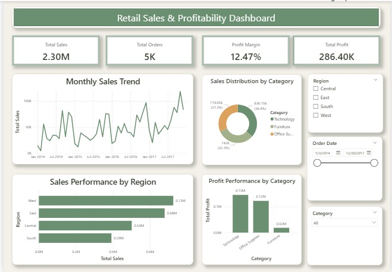
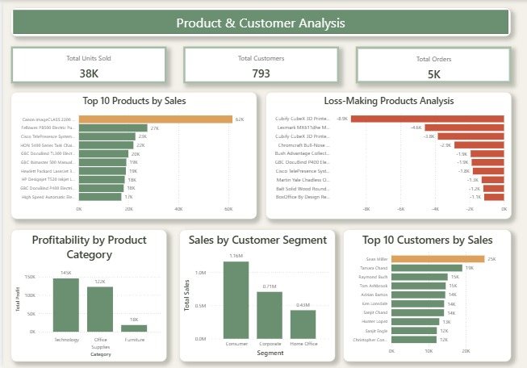
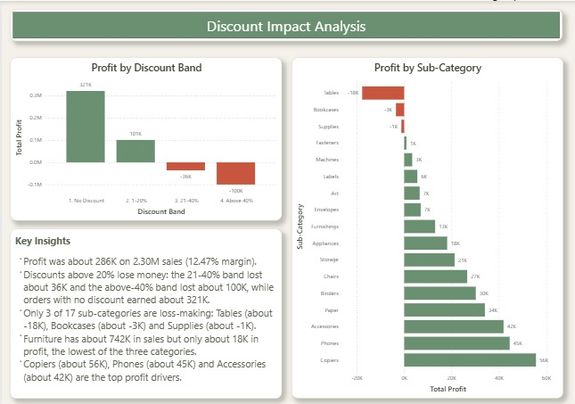

# Retail Sales & Profitability Dashboard | Power BI

## Project Overview

This project is an interactive 3-page Power BI dashboard built using the Superstore retail sales dataset.

The main purpose of this project is to understand business performance by analysing sales, profit, customers, products, regions and discount levels.

The dashboard helps identify:
- Which regions and product categories generate the highest sales.
- Which products and sub-categories generate the most profit or loss.
- Which customer segments contribute to sales.
- How different discount levels are associated with profitability.
- Which areas may need business improvement.

## Dashboard Preview

### 1. Sales Overview

This page provides an overall view of business performance.



**Key features:**
- Total Sales
- Total Profit
- Total Orders
- Profit Margin
- Monthly Sales Trend
- Sales Performance by Region
- Sales Distribution by Category
- Profit Performance by Category
- Interactive slicers for Region, Order Date and Category

### 2. Product & Customer Analysis

This page focuses on product performance and customer contribution.



**Key features:**
- Top 10 Products by Sales
- Top 10 Customers by Sales
- Sales by Customer Segment
- Profitability by Product Category
- Bottom 10 Products by Profit (loss-making products)
- Total Units Sold

### 3. Discount Impact

This page analyses how different discount levels are associated with business profitability.



**Key features:**
- Profit by Discount Band
- Profit by Sub-Category
- Analysis of 17 product sub-categories
- Key Business Insights
- Business Recommendations

---

## Dataset Information

**Dataset:** Superstore Retail Sales Dataset

- **Total records:** 9,994
- **Data period:** January 2014 – December 2017
- **Data type:** Retail sales transactions

**Important columns used:**
- Order Date
- Region
- Segment
- Category
- Sub-Category
- Product Name
- Customer ID
- Customer Name
- Order ID
- Sales
- Quantity
- Discount
- Profit

The dataset contains sales transactions and product, customer and regional information.

**Dataset source:** Kaggle – Superstore Dataset  
**Dataset URL:** https://www.kaggle.com/datasets/bravehart101/sample-supermarket-dataset

---

## Tools and Technologies

| Tool | Purpose |
|---|---|
| Power BI Desktop | Dashboard development and data visualisation |
| DAX | Creating calculated measures and columns |
| CSV | Source data format |

---

## Key Performance Indicators (KPIs)

The dashboard uses the following seven DAX measures:

| KPI | Description |
|---|---|
| Total Sales | Total sales revenue |
| Total Profit | Total profit generated |
| Total Orders | Number of unique orders |
| Total Customers | Number of unique customers |
| Total Quantity | Total units sold |
| Profit Margin | Profit as a percentage of sales |
| Average Order Value | Average sales value per order |

### DAX Measures

**1. Total Sales**
```dax
Total Sales =
SUM('Superstore'[Sales])
```

**2. Total Profit**
```dax
Total Profit =
SUM('Superstore'[Profit])
```

**3. Total Orders**
```dax
Total Orders =
DISTINCTCOUNT('Superstore'[Order ID])
```

**4. Total Customers**
```dax
Total Customers =
DISTINCTCOUNT('Superstore'[Customer ID])
```

**5. Total Quantity**
```dax
Total Quantity =
SUM('Superstore'[Quantity])
```

**6. Profit Margin**
```dax
Profit Margin =
DIVIDE(
    [Total Profit],
    [Total Sales],
    0
)
```

**7. Average Order Value**
```dax
Average Order Value =
DIVIDE(
    [Total Sales],
    [Total Orders],
    0
)
```

### Calculated Column – Discount Band

A calculated column was created using `SWITCH(TRUE())` to group discount values into four categories.

```dax
Discount Band =
SWITCH(
    TRUE(),
    'Superstore'[Discount] = 0, "1. No Discount",
    'Superstore'[Discount] <= 0.2, "2. 1-20%",
    'Superstore'[Discount] <= 0.4, "3. 21-40%",
    "4. Above 40%"
)
```

The four discount groups are:
- 1. No Discount
- 2. 1-20%
- 3. 21-40%
- 4. Above 40%

This grouping helps compare profitability across different discount ranges. The number prefixes also help maintain the intended category order in the report.

---

## Key Business Insights

The following findings were identified from the dashboard:

### 1. Overall Business Performance

- **Total Sales:** Approximately 2.30M
- **Total Profit:** Approximately 286.40K
- **Total Orders:** Approximately 5K
- **Profit Margin:** Approximately 12.47%

The business generated approximately 286.40K profit on 2.30M sales.

### 2. Discount and Profitability

The profit results across discount bands were:

| Discount Band | Approximate Profit |
|---|---:|
| No Discount | +321K |
| 1–20% | +101K |
| 21–40% | -36K |
| Above 40% | -100K |

**Observation:** The two discount bands above 20% showed negative profit in this dataset. This suggests that higher discount levels are associated with lower profitability in the analysed data. This relationship does not, by itself, prove that discounts caused the losses.

### 3. Product Sub-Category Performance

Out of 17 sub-categories, only three generated negative profit:

| Sub-Category | Approximate Profit |
|---|---:|
| Tables | -18K |
| Bookcases | -3K |
| Supplies | -1K |

Tables and Bookcases are part of the Furniture category.

### 4. Category Performance

- **Technology:** Approximately 145K profit.
- **Office Supplies:** Approximately 122K profit.
- **Furniture:** Approximately 18K profit.

Furniture had approximately 742K in sales but generated considerably less profit than the other two categories.

### 5. Top Profit-Generating Sub-Categories

The strongest profit contributors included:

- **Copiers:** Approximately 56K
- **Phones:** Approximately 45K
- **Accessories:** Approximately 42K

---

## Business Recommendations

Based on the dashboard findings, the following actions could be considered:

1. **Review high discounts:** Review discount policies above 20%, as these discount bands showed negative profit in the dataset.
2. **Improve Furniture profitability:** Investigate pricing, costs and discounting for Tables and Bookcases.
3. **Focus on profitable products:** Protect and promote strong profit-generating sub-categories such as Copiers, Phones and Accessories.
4. **Monitor business performance:** Regularly track sales, profit and profit margin across regions and categories.

---

## Project Limitations

- The dataset does not provide a detailed cost breakdown.
- The analysis identifies relationships between discounts and profitability, but does not prove that discounts alone caused losses.
- Further analysis of individual products and sub-categories would help understand the reasons behind negative profit.
- The findings are based on the available dataset and the selected reporting period.

---

## What I Learned

Through this project, I practised:

- Importing CSV data into Power BI.
- Working with retail sales data.
- Creating DAX measures and calculated columns.
- Building interactive dashboards and KPI cards.
- Creating bar charts, column charts, line charts and donut charts.
- Analysing product, customer and regional performance.
- Comparing profitability across discount ranges.
- Presenting business findings through visual reports.

---

## Repository Structure

```text
Power-BI-Projects/
│
└── Retail-Sales-Profitability-Dashboard/
    │
    ├── README.md
    │
    ├── dashboard/
    │   └── Retail_Sales_Business_Analysis.pbix
    │
    ├── Screenshots/
    │   ├── sales_overview.jpeg
    │   ├── product_customer_analysis.jpeg
    │   └── discount_impact.jpeg
    │
    ├── dataset/
    │   └── Superstore.csv
    │
    ├── documentation/
    │   └── Retail_Sales_Business_Analysis.pdf
    │
    └── DAX/
        └── measures.dax
```

---

## Conclusion

This project demonstrates how Power BI and DAX can be used to analyse retail business data and convert it into meaningful business insights.

It provides an overview of sales performance, customer contribution, product profitability and discount impact, helping identify areas for improvement and better business decisions.
